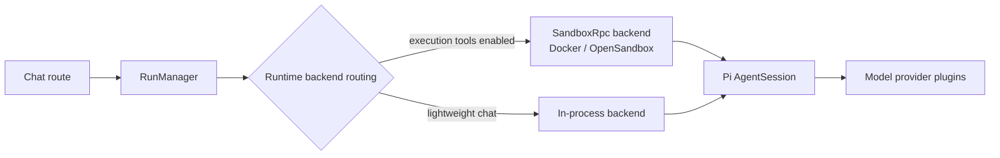

<a id="readme-top"></a>

<div align="center">


# piwork

**An enterprise AI agent platform built on the [Pi Agent](https://github.com/earendil-works/pi) SDK — chat, skills, sandboxed execution, and organization management in a single Next.js app.**

[](./LICENSE)
[](https://nextjs.org)
[](https://react.dev)
[](https://www.npmjs.com/package/@earendil-works/pi-coding-agent)
[](https://nodejs.org)
[](https://github.com/robotbird/piwork/stargazers)

[Quick Start](#-quick-start) · [Features](#-features) · [Report an Issue](https://github.com/robotbird/piwork/issues)

**English** | [简体中文](README.zh-CN.md)

</div>

<details open>
<summary><b>📖 Table of Contents</b></summary>

- [✨ Features](#-features)
- [📦 Installation](#-installation)
  - [Prerequisites](#prerequisites)
- [🚀 Quick Start](#-quick-start)
- [📖 Usage](#-usage)
- [🧱 Architecture](#-architecture)
- [🧭 Roadmap](#-roadmap)
- [🤝 Contributing](#-contributing)
- [📄 License](#-license)

</details>

## ✨ Features

- 💬 **Multi-user AI chat** — streaming responses, file attachments, and a personal document library
- 🔌 **Model provider plugins** — DeepSeek, Tongyi, and ZhipuAI ship built-in; add your own with the provider SDK
- 🛠️ **Skills & Pi Packages** — manage agent skills in the admin console, including multi-select install from links; skill scripts run only inside a sandbox
- 🧱 **Sandboxed execution** — agent tools (`bash`/`read`/`write`/`edit`) execute in Docker- or OpenSandbox-backed runtimes, isolated from the host; pure chat stays in-process
- 📁 **Project workspaces** — attach documents and images as project sources, with per-project chat history
- ⏰ **Scheduled tasks** — cron-style recurring agent tasks with run history
- 🤝 **Chat collaboration** — share chats with teammates, live presence and typing indicators
- 🏢 **Organization management** — members, departments, and roles with per-role model permissions and token quotas
- 🔍 **Optional web search** — integrate [Tavily](https://tavily.com) as a platform-hosted search tool
- 🌐 **Internationalization** — English and Simplified Chinese UI

<p align="right">(<a href="#readme-top">back to top ⬆️</a>)</p>

## 📦 Installation

### Prerequisites

- [Node.js](https://nodejs.org) >= 22
- [pnpm](https://pnpm.io) 10.32.1 (`corepack enable`)
- A [PostgreSQL](https://www.postgresql.org) database

### Install dependencies

```bash
corepack enable
pnpm install
```

<p align="right">(<a href="#readme-top">back to top ⬆️</a>)</p>

## 🚀 Quick Start

1. Configure environment variables (see [.env.example](.env.example)):

   ```bash
   cp .env.example .env.local
   # set POSTGRES_URL, AUTH_SECRET, and at least one model API key
   ```

2. Apply the database schema and start the dev server:

   ```bash
   pnpm db:migrate
   pnpm dev
   ```

3. Open <http://localhost:3000>, register an account, then configure a provider (API key) under **Admin → Models**.
4. Start chatting. The chat path never falls back to a static model — if the model catalog is empty, configure a provider first.

<p align="right">(<a href="#readme-top">back to top ⬆️</a>)</p>

## 📖 Usage

### Model providers

Manage providers under **Admin → Models**. Each provider plugin supplies the model catalog; credentials are stored server-side and never exposed to sandboxes.

### Skills

Under **Admin → Skills**, upload skill archives or install multiple skills at once from a link. Skill bundles are size- and count-limited, and skill scripts execute only inside the sandbox runtime.

### Project workspaces

Create a project, upload documents and images as sources, and chat with the full project context. Project chats always run through the sandboxed runtime.

### Sandbox runtime (optional)

By default everything runs in-process. To enable sandboxed execution:

<details>
<summary>Environment variables</summary>

```bash
PIWORK_SANDBOX_PROVIDER=docker          # docker | opensandbox; unset = in-process
PIWORK_SANDBOX_IMAGE=pi-runtime:dev     # build from docker/pi-runtime/Dockerfile
PIWORK_SANDBOX_CLI_PATH=/opt/pi/node_modules/@earendil-works/pi-coding-agent/dist/bundle/cli.js

# OpenSandbox additionally requires:
# OPENSANDBOX_DOMAIN=...
# OPENSANDBOX_API_KEY=...
```

</details>

### Testing

```bash
pnpm exec tsc --noEmit   # type check
pnpm test:unit           # unit tests
pnpm test:runtime        # runtime tests
pnpm test:runtime:db     # DB tests (needs local PostgreSQL)
pnpm test                # Playwright E2E
pnpm check               # lint (Biome via Ultracite)
```

All tests live under `tests/` (unit in `tests/unit`, E2E in `tests/e2e`).

<p align="right">(<a href="#readme-top">back to top ⬆️</a>)</p>

## 🧱 Architecture

Every chat message flows through one direction of responsibility:



- Pure-conversation runs stay in-process; runs with execution tools are routed to a sandboxed runtime — never silently downgraded.
- Runtime events are normalized and streamed to the UI; runs and message history persist in PostgreSQL.
- See [AGENTS.md](AGENTS.md) for repository conventions. Full architecture docs are on the roadmap.

<p align="right">(<a href="#readme-top">back to top ⬆️</a>)</p>

## 🧭 Roadmap

- [ ] Publish full architecture and operations documentation
- [ ] CONTRIBUTING.md and SECURITY.md
- [ ] More UI languages
- [ ] OpenSandbox production provider hardening
- [ ] Durable execution pilot (currently experimental)

<p align="right">(<a href="#readme-top">back to top ⬆️</a>)</p>

## 🤝 Contributing

Issues and pull requests are welcome!

- Write commit messages **in English** following [Conventional Commits](https://www.conventionalcommits.org/) — for example `feat(chat): ...` or `fix(runtime): ...`
- Read [AGENTS.md](AGENTS.md) for repository conventions before making changes
- A dedicated contributing guide is on the roadmap

<p align="right">(<a href="#readme-top">back to top ⬆️</a>)</p>

## 📄 License

Distributed under the [Apache License 2.0](./LICENSE). Portions of this project are derived from the [Vercel AI Chatbot template](https://github.com/vercel/ai-chatbot) — see [NOTICE](./NOTICE).

**Use is free** for research, education, and internal deployment within a company — no permission required.

**Commercial licensing**: if you plan to resell piwork, redistribute it under your own brand, or offer it as a paid hosted product, please [contact the author](https://github.com/robotbird) for a commercial license and brand cooperation. The "piwork" name and logo are reserved trademarks of the project owner and are not part of the licensed work.

<p align="right">(<a href="#readme-top">back to top ⬆️</a>)</p>
