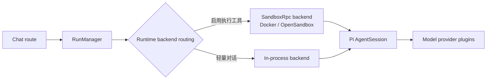

<a id="readme-top"></a>

<div align="center">


# piwork

**基于 [Pi Agent](https://github.com/earendil-works/pi) SDK 的企业智能体平台 —— 聊天、Skill、沙箱执行与组织管理，集成于单个 Next.js 应用。**

[](./LICENSE)
[](https://nextjs.org)
[](https://react.dev)
[](https://www.npmjs.com/package/@earendil-works/pi-coding-agent)
[](https://nodejs.org)
[](https://github.com/robotbird/piwork/stargazers)

[快速开始](#-快速开始) · [特性](#-特性) · [报告问题](https://github.com/robotbird/piwork/issues)

[English](README.md) | **简体中文**

</div>

<details open>
<summary><b>📖 目录</b></summary>

- [✨ 特性](#-特性)
- [📦 安装](#-安装)
  - [前提条件](#前提条件)
- [🚀 快速开始](#-快速开始)
- [📖 用法](#-用法)
- [🧱 架构](#-架构)
- [🧭 路线图](#-路线图)
- [🤝 贡献](#-贡献)
- [📄 开源协议](#-开源协议)

</details>

## ✨ 特性

- 💬 **多用户 AI 聊天** —— 流式响应、文件附件与个人文档库
- 🔌 **模型供应商插件** —— 内置 DeepSeek、通义、智谱；可通过 provider SDK 接入更多供应商
- 🛠️ **Skill 与 Pi Package** —— 在管理端维护 Skill，支持从链接多选安装；Skill 脚本仅在沙箱内执行
- 🧱 **沙箱执行** —— agent 工具（`bash`/`read`/`write`/`edit`）在 Docker 或 OpenSandbox 运行时中执行，与宿主隔离；纯对话保持进程内运行
- 📁 **项目工作区** —— 将文档与图片作为项目资料，项目聊天携带完整上下文
- ⏰ **定时任务** —— cron 周期任务与运行历史
- 🤝 **聊天协作** —— 与同事分享对话，实时 presence 与输入状态
- 🏢 **组织管理** —— 成员、部门与角色，支持按角色的模型权限与 Token 额度
- 🔍 **可选联网搜索** —— 集成 [Tavily](https://tavily.com) 作为平台侧搜索工具
- 🌐 **国际化** —— 简体中文与英文界面

<p align="right">(<a href="#readme-top">回到顶部 ⬆️</a>)</p>

## 📦 安装

### 前提条件

- [Node.js](https://nodejs.org) >= 22
- [pnpm](https://pnpm.io) 10.32.1（`corepack enable`）
- [PostgreSQL](https://www.postgresql.org) 数据库

### 安装依赖

```bash
corepack enable
pnpm install
```

<p align="right">(<a href="#readme-top">回到顶部 ⬆️</a>)</p>

## 🚀 快速开始

1. 配置环境变量（参考 [.env.example](.env.example)）：

   ```bash
   cp .env.example .env.local
   # 设置 POSTGRES_URL、AUTH_SECRET，以及至少一个模型 API key
   ```

2. 初始化数据库并启动开发服务器：

   ```bash
   pnpm db:migrate
   pnpm dev
   ```

3. 打开 <http://localhost:3000>，注册账号，然后在 **管理 → 模型** 中配置供应商（API key）。
4. 开始对话。聊天链路不会在模型目录为空时回退到静态模型 —— 请先配置至少一个供应商。

<p align="right">(<a href="#readme-top">回到顶部 ⬆️</a>)</p>

## 📖 用法

### 模型供应商

在 **管理 → 模型** 中维护供应商。每个 provider 插件提供模型目录；凭据只保存在服务端，不会暴露给沙箱。

### Skill

在 **管理 → Skill** 中上传 Skill 压缩包，或从链接一次安装多个 Skill。Skill 包有数量与体积上限，脚本仅在沙箱运行时中执行。

### 项目工作区

创建项目，上传文档与图片作为资料，即可在项目聊天中使用完整上下文。项目聊天固定走沙箱运行时。

### 沙箱运行时（可选）

默认全部进程内执行。启用沙箱执行：

<details>
<summary>环境变量</summary>

```bash
PIWORK_SANDBOX_PROVIDER=docker          # docker | opensandbox；不设置 = 进程内
PIWORK_SANDBOX_IMAGE=pi-runtime:dev     # 由 docker/pi-runtime/Dockerfile 构建
PIWORK_SANDBOX_CLI_PATH=/opt/pi/node_modules/@earendil-works/pi-coding-agent/dist/bundle/cli.js

# OpenSandbox 另需：
# OPENSANDBOX_DOMAIN=...
# OPENSANDBOX_API_KEY=...
```

</details>

### 测试

```bash
pnpm exec tsc --noEmit   # 类型检查
pnpm test:unit           # 单元测试
pnpm test:runtime        # runtime 测试
pnpm test:runtime:db     # DB 测试（需本地 PostgreSQL）
pnpm test                # Playwright E2E
pnpm check               # lint（Biome / Ultracite）
```

所有测试位于 `tests/`（单元测试 `tests/unit`，E2E `tests/e2e`）。

<p align="right">(<a href="#readme-top">回到顶部 ⬆️</a>)</p>

## 🧱 架构

每条聊天消息沿单一职责方向流转：



- 纯对话 run 保持进程内；启用执行工具的 run 路由到沙箱运行时，绝不静默降级。
- Runtime 事件归一化后流式输出到前端；run 与消息历史持久化到 PostgreSQL。
- 仓库约定见 [AGENTS.md](AGENTS.md)。完整架构文档在路线图中。

<p align="right">(<a href="#readme-top">回到顶部 ⬆️</a>)</p>

## 🧭 路线图

- [ ] 发布完整架构与运维文档
- [ ] CONTRIBUTING.md 与 SECURITY.md
- [ ] 更多界面语言
- [ ] OpenSandbox 生产级 provider 加固
- [ ] Durable 执行试点（当前为实验特性）

<p align="right">(<a href="#readme-top">回到顶部 ⬆️</a>)</p>

## 🤝 贡献

欢迎提交 Issue 与 Pull Request！

- 提交信息使用**英文**并遵循 [Conventional Commits](https://www.conventionalcommits.org/)，例如 `feat(chat): ...`、`fix(runtime): ...`
- 修改代码前请先阅读 [AGENTS.md](AGENTS.md) 中的仓库约定
- 独立的贡献指南在路线图中

<p align="right">(<a href="#readme-top">回到顶部 ⬆️</a>)</p>

## 📄 开源协议

本项目基于 [Apache License 2.0](./LICENSE) 开源。部分代码派生自 [Vercel AI Chatbot 模板](https://github.com/vercel/ai-chatbot)，见 [NOTICE](./NOTICE)。

**研究、教学与企业内部使用完全免费**，无需获得任何授权。

**商业售卖**：如需转售 piwork、以自有品牌二次分发，或将其作为付费托管产品提供，请[联系作者](https://github.com/robotbird)获取商业授权与品牌合作。"piwork" 名称与 Logo 为项目所有者的保留商标，不在开源许可授予范围内。

<p align="right">(<a href="#readme-top">回到顶部 ⬆️</a>)</p>
